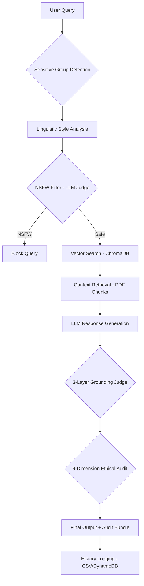

# System Architecture: RTI Ethics Engine

This document provides a rigorous technical overview of the RTI Ethics Engine's architecture, detailing the query processing pipeline, the 3-layer grounding stack, and the recursive ethical audit protocol.

## 1. End-to-End Query Flow

The system operates as a Retrieval-Augmented Generation (RAG) pipeline reinforced by a multi-dimensional ethical oversight layer.

### High-Level Stages:

1.  **Ingestion & Pre-processing**: Detects user profile (Urban/Formal vs Rural/Traditional) to ensure fairness across linguistic cohorts.
2.  **Safety Gate**: An LLM-based NSFW judge scans for inappropriate content before any retrieval occurs.
3.  **RAG Core**: Uses `all-MiniLM-L6-v2` embeddings and ChromaDB (Cosine Space) to find relevant statutory sections in RTI documents.
4.  **Generation**: Llama 3 produces a legalistic response restricted strictly to the retrieved context.

---

## 2. The 3-Layer Grounding Judge

To prevent hallucinations, the system employs a deterministic evaluation stack:

| Layer  | Metric                 | Mechanism                                                                | Purpose                                           |
| :----- | :--------------------- | :----------------------------------------------------------------------- | :------------------------------------------------ |
| **L1** | **Citation Coverage**  | Regex-based pattern matching for legal citations (Sections, Acts).       | Ensures response is rooted in legal authority.    |
| **L2** | **Semantic Grounding** | Cosine similarity between Response and Context embeddings.               | Validates thematic alignment.                     |
| **L3** | **Claim Support**      | Sentence-level overlap check in retrieved chunks (50-char prefix match). | Verifies factual grounding for individual claims. |

**Formula**: $\text{Grounding Score} = 0.4(L1) + 0.3(L2) + 0.3(L3)$

---

## 3. The 9-Dimension Ethical Audit Protocol

The RTI Ethics Engine runs an exhaustive audit across 9 dimensions, each processed through three hierarchical layers.

### The 9 Dimensions & Weights (Step 904)

The system uses **Weighted Linear Risk Aggregation ($S_{LLM}$)** with raw policy weights (Sum = 1.24, non-normalized for policy adherence).

| Dimension            | Weight | Primary Focus                            |
| :------------------- | :----- | :--------------------------------------- |
| **Legal Compliance** | 0.20   | Statutory alignment with RTI Act 2005.   |
| **Bias & Fairness**  | 0.20   | Demographic parity (SPD, DI, EOP).       |
| **Explainability**   | 0.16   | Saliency consistency and transparency.   |
| **Security**         | 0.16   | Resistance to prompt injection.          |
| **Monitoring**       | 0.16   | Integrity of the audit trail (ALC, SLA). |
| **Performance**      | 0.12   | Core statistical accuracy and recall.    |
| **Human AI-UX**      | 0.12   | Reading complexity matching (FK Score).  |
| **Model Drift**      | 0.08   | Distributional stability (PSI, KS).      |
| **Environmental**    | 0.04   | Compute efficiency and cost overhead.    |

### The 3 Hierarchical Layers

Each dimension is evaluated as follows:

1.  **Layer 1 (Hard Gates)**: Strict mathematical boundary. If a dimension fails its L1 gate (e.g., Accuracy < 0.8), it is automatically assigned **MAX RISK (1.0)** for L2.
2.  **Layer 2 (Risk Scoring)**: Calculates a normalized risk score $[0, 1]$. These are multiplied by weights and summed to produce the $S_{LLM}$ score.
3.  **Layer 3 (Forensic Evidence)**: Generates human-readable "Audit Trail" bundles, explaining exactly why a dimension passed or failed (e.g., "DI 0.75 out of range").

---

## 4. Decision Logic & Risk Bands

Based on the aggregated risk, the system assigns a Final Label:

- **$\text{Risk} < 0.3 \to$ ETHICAL (LOW RISK)**: Proceed normally.
- **$\text{Risk} \in [0.3, 0.7] \to$ CONDITIONALLY_ETHICAL (MEDIUM RISK)**: Flag for human review.
- **$\text{Risk} > 0.7 \to$ UNETHICAL (HIGH RISK)**: Block and review.
- **L1 Gate Failure $\to$ CONDITIONALLY_ETHICAL**: Immediate flag for the specific dimension breach.

---

## 5. Implementation Stack

- **Vector Store**: ChromaDB (hnsw:space:cosine).
- **Embeddings**: `sentence-transformers/all-MiniLM-L6-v2`.
- **Inference**: Ollama (Local) / OpenRouter (Cloud Lambda) using Llama 3 architecture.
- **Persistence**: `conversations_metrics.csv` (Local) / Amazon DynamoDB + S3 (Cloud).
