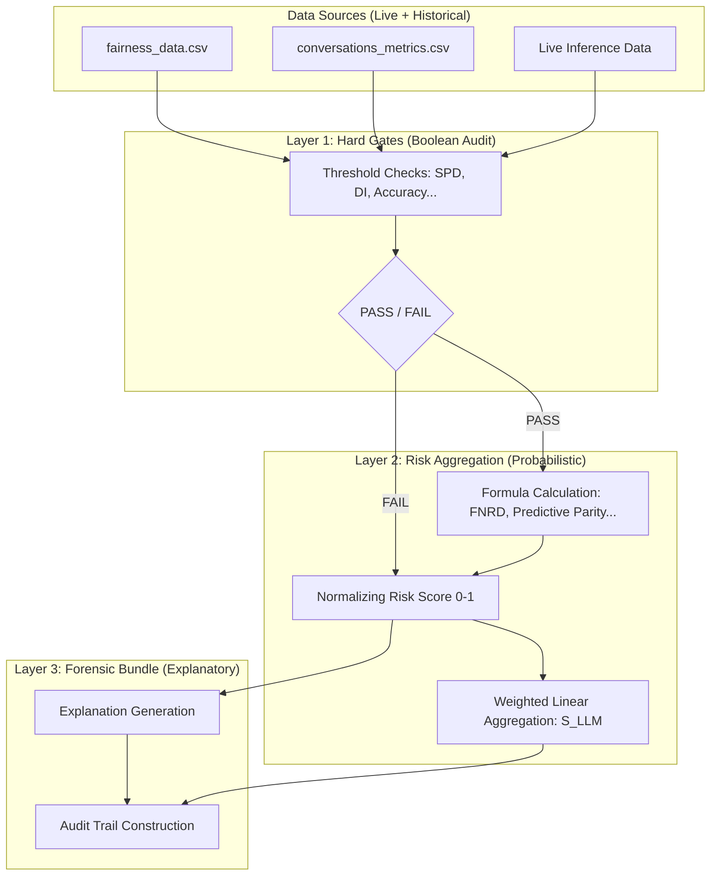

# Metric & Data Source Mapping: RTI Ethics Engine

This document provides a rigorous mapping of the ethical formulas used in the `rti-ethics-engine` package to their respective data sources (CSV columns/Runtime variables) and visualizes the 3-layer calculation architecture.

## 1. 3-Layer Calculation Architecture

The following diagram illustrates how raw data is transformed through the three distinct layers of the ethical audit.

---

## 2. CSV & Formula Mapping

The `build_metrics_from_raw_data` function acts as the bridge between the database/logs and the engine.

### A. From `fairness_data.csv`

| CSV Column              | Engine Input     | Used in Level 1 & 2 Formulas                                                                                                            |
| :---------------------- | :--------------- | :-------------------------------------------------------------------------------------------------------------------------------------- |
| `sensitive_group`       | `sensitive_attr` | **SPD** (Stat. Parity), **DI** (Disparate Impact), **EOP** (Eq. Opportunity), **AOD** (Avg. Odds), **FNRD** (False Negative Rate Diff). |
| `ground_truth_disclose` | `labels`         | **Accuracy**, **Recall**, **EOP**, **AOD**, **FNRD**, **Group F1**.                                                                     |
| `system_disclose`       | `predictions`    | **SPD**, **DI**, **Accuracy**, **Recall**, **Predictive Parity**, **Refusal Disparity**.                                                |

### B. From `conversations_metrics.csv`

| CSV Column          | Engine Input        | Used in Level 1 & 2 Formulas                                                           |
| :------------------ | :------------------ | :------------------------------------------------------------------------------------- |
| `latency_ms`        | `latency_ms`        | **Inference Cost** (USD), **GPU Hours**, **SLA Compliance**.                           |
| `output_tokens`     | `output_tokens`     | **Compute Intensity** (FLOPs/Token), **Estimated Cost**.                               |
| `grounding_score`   | `grounding_score`   | **Explanation Confidence**, **Performance Proxy** (for Acc/Recall if no labels exist). |
| `citation_coverage` | `citation_coverage` | **Feature Importance (FI)**, **Legal Basis Assessment**.                               |

### C. Live Inference Data (Calculated via `text.py`)

| Source Data        | Calculation Method      | Used in Formulas                                                                        |
| :----------------- | :---------------------- | :-------------------------------------------------------------------------------------- |
| `ai_response` text | Regex & FK-Readability  | **Lawfulness**, **TCR** (Task Completion), **Flesch-Kincaid** (UX), **Cognitive Load**. |
| `user_query` text  | Regex & Group Detection | **sensitive_group** classification, **Security Injection Checks**, **NSFW Flag**.       |

---

## 3. Formula Summary for the 3 Layers

| Layer       | Formula Logic                                       | Penalty Behavior                                                                                     |
| :---------- | :-------------------------------------------------- | :--------------------------------------------------------------------------------------------------- |
| **Layer 1** | $V_{metric} \lessgtr \tau_{threshold}$              | If $FAIL$, current dimension Risk $R = 1.0$ (Max).                                                   |
| **Layer 2** | $R_{dim} = \sum (w_i \cdot m_i)$                    | Aggregates minor metric variations into a $[0, 1]$ risk vector.                                      |
| **Layer 3** | $\text{Explanation} = f(L1, L2, \text{indicators})$ | Strings together tokens like `"DI out of range (0.75)"` or `"Max risk due to Accuracy Gate breach"`. |
